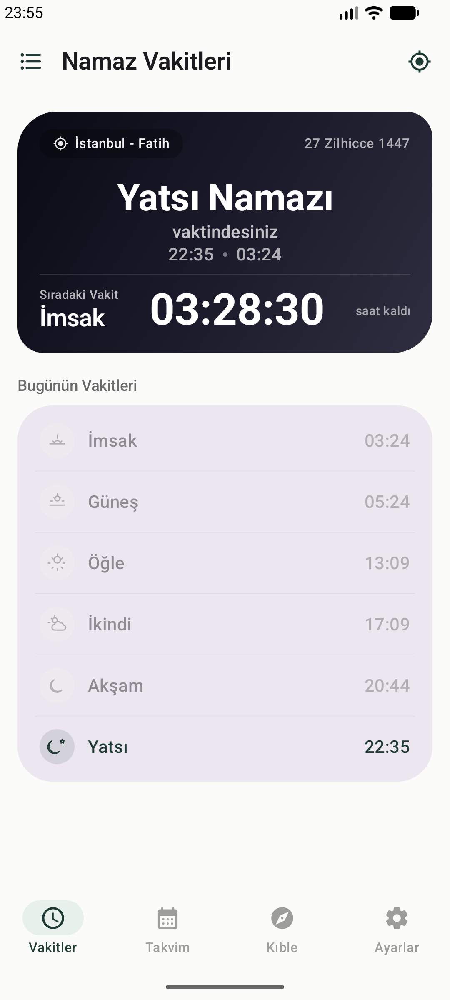
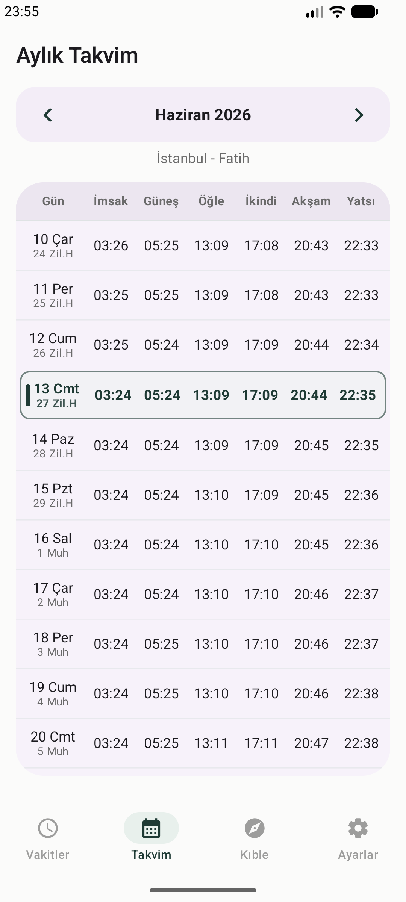
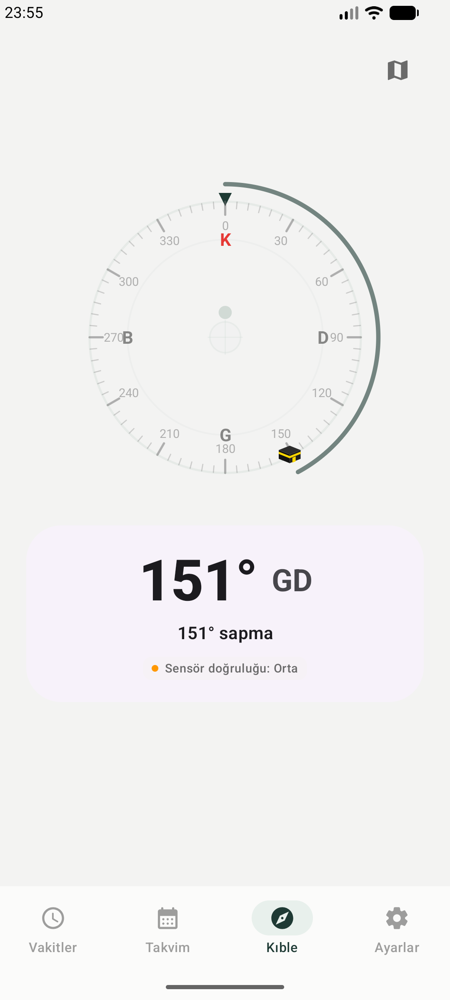
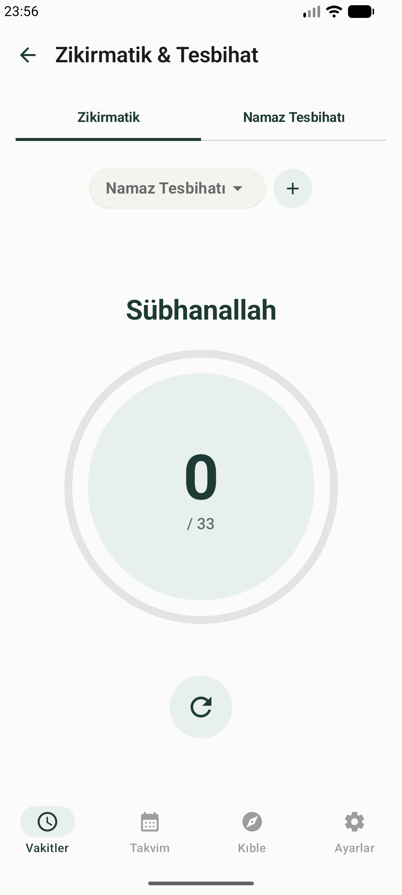
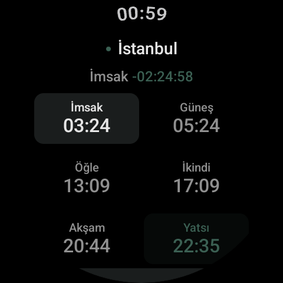

<div align="center">
  
  <h1>Namaz Vakitleri</h1>
  <p><b>Android &amp; Wear OS için Konum Bazlı Namaz Vakitleri Uygulaması</b></p>
  <p>Jetpack Compose + Clean Architecture + MVVM — ücretsiz ve açık kaynak (GPLv3)</p>

  [](https://kotlinlang.org)
  [](https://developer.android.com/compose)
  [](https://developer.android.com/build)
  [](https://kotlinlang.org/docs/ksp-overview.html)
  [](https://gradle.org)
  [](https://developer.android.com/tools/releases/platforms)
  [](https://github.com/GorkemGuray/Namaz/releases/latest)
  [](LICENSE)
  [](docs/05-test-ve-kalite.md)
</div>

---

## 📥 İndir

Hazır APK'lar her sürümde otomatik derlenip yayınlanır — kod derlemenize gerek yok:

- 📱 **Telefon:** [`Namaz-{sürüm}-app-debug.apk`](https://github.com/GorkemGuray/Namaz/releases/latest)
- ⌚ **Akıllı saat:** [`Namaz-{sürüm}-wear-debug.apk`](https://github.com/GorkemGuray/Namaz/releases/latest)

Uygulama yeni sürümü kendisi de haber verir: ana ekrandaki banner veya Ayarlar → "Güncellemeleri Kontrol Et".

> **Minimum gereksinim:** Android 7.0 (API 24) ve üzeri telefonlar · Wear OS 4.0 (API 30) ve üzeri saatler.

---

## ✨ Öne Çıkan Özellikler

### 🕰️ Konum Bazlı Vakitler — Üç Kaynak
| # | Kaynak | Kapsam | İnternet |
|---|--------|--------|:---:|
| 1 | **Diyanet (İmsakiyem API)** | Türkiye — resmi ilçe bazlı | ✓ |
| 2 | **Aladhan API** *(varsayılan)* | Dünya geneli — koordinat bazlı | ✓ |
| 3 | **Lokal Hesaplama** | Cihaz içi astronomik motor | ✗ |

İnternet yoksa uygulama otomatik olarak lokal hesaplamaya düşer. Türkçe karakter ve büyük/küçük harf sorunları çözülmüştür (`kırklareli`, `üsküdar`, `kadıköy` yazsanız dahi bulur).

<p align="center">
  
  
  
  
</p>

### 🎨 11 Tema — Her Ekranda Senkronize
Telefondan seçtiğiniz tema anında akıllı saatinize ve ana ekran widget'ınıza yansır. İlk 4 tema aydınlık/karanlık moda uyum sağlar, diğer 7'si sabit görünümlüdür.

Emerald Oasis *(varsayılan)* · Sapphire Night · Amber Sands · Monochrome Platinum · Yumuşak Aydınlık · Tam Aydınlık · Saman Kâğıdı · Karanlık · Galaksi · Gün Batımı · Amber Gece

### 📿 Zikirmatik, Kaza Takibi, Ramazan ve Kandiller
- **Namaz Tesbihatı:** Diyanet rehberine uygun, Arapça + Türkçe okunuş + anlam, 33'lük adım adım rehberli akış.
- **Serbest Sayaç:** Hedefli (33/99/100/1000) veya sınırsız, ilerleme halkası, haptik geri bildirim.
- **Kaza Takibi:** 6 vakit için kalıcı sayaçlar (Ayarlar'da).
- **Ramazan Modu:** Ramazan ayında sahur/iftar çift sayacı.
- **Cuma/Kandil:** Özel gün sabahı bildirim + ana ekranda banner. Kandil takvimi guard test ile denetlenir.

### 🔊 Ezan Sesi
Ayarlardaki "Ezan sesi" açıldığında bildirimler sesli kanaldan gelir: CC0 lisanslı ezan kaydı, ilk 10 saniyede kademeli yükselir. "Sesi Dene" butonuyla önizleme yapılabilir.

### 🧭 Kıble Pusulası ve Harita
- **Sin/Cos yumuşatma:** 360°→0° sarmalamasında titremez; histerezisli hizalanma algısı (≤4° gir, ≥6.5° çık).
- **Hizalanma efektleri:** ±5°'de titreşim + glow + parçacıklar.
- **MapLibre harita:** Kabe yönünü zümrüt Great Circle hattıyla sokak seviyesinde gösterir.
- Manyetometre yoksa statik yön + derece ile çalışır.

### ⌚ Wear OS — Telefon Olmadan da Çalışır
- **Senkronizasyon:** Vakit + konum + tema + dil Data Layer API ile saate anında iletilir.
- **Bağımsız mod:** Telefon yoksa saat kendi GPS'iyle Aladhan veya Diyanet'ten çeker.
- **2×3 ızgara**, SwipeDismissableNavHost, kıble pusulası, zikirmatik, Tile ve kadran komplikasyonları (native geri sayım dahil).

<p align="center">
  
</p>

### 📱 Glance Widget — Pil Dostu
- **Native Chronometer:** Geri sayım Launcher/SystemUI tarafından işletilir — uygulama uyurken **%0 CPU, %0 wake lock**.
- **Kerahat modu:** Kerahatte kart kırmızıya döner, hedef kerahat bitişine ayarlanır.
- **Dakikalık tick + vakit geçiş alarmı**, reboot sonrası otomatik yeniden kurulum.

### 🔔 Bildirimler ve Güncelleme
- 6 vakit için ayrı zamanlanmış bildirim + özel gün (kandil/cuma) sabah hatırlatıcısı.
- Uygulama içi güncelleme kontrolü: yeni sürümde ana ekranda banner, tek dokunuşla GitHub Releases.

---

## 🔋 Arka Plan ve Pil

Üç yedekli konum mekanizması, hiçbiri pili yormaz:

| Yol | Mekanizma | Pil |
|-----|-----------|:---:|
| Dakikalık tick | Önbellek `lastLocation` | ~0 |
| Periyodik worker | 12 saatte bir, `BATTERY_NOT_LOW` | ~2-3 sn CPU |
| Pasif dinleyici | 10 km displacement (arka plan izniyle) | Düşük |

## 🧪 Test

30 test dosyası (mobil 23, Wear 6, paylaşılan 1) — TDD zorunludur, her görev test yeşili + commit ile biter:

```bash
./gradlew test                 # Tümü
./gradlew :app:test            # Sadece mobil
./gradlew :wear:test           # Sadece Wear OS
./gradlew :core:test           # Sadece paylaşılan modül
```

---

## 🛠️ Kurulum ve Derleme

```bash
# Gereksinim: JDK 11+ (CI JDK 17 kullanır), Android SDK 36
git clone https://github.com/GorkemGuray/Namaz.git
cd Namaz

./gradlew assembleDebug        # Mobil + Wear OS + core
./gradlew :app:assembleDebug   # Sadece mobil
./gradlew :wear:assembleDebug  # Sadece Wear OS
```

Emülatör konum testi ve diğer ipuçları: [`docs/05-test-ve-kalite.md`](docs/05-test-ve-kalite.md).

## 📐 Mimari

```
┌─────────────────────────────────────┐
│  UI Layer (Compose)                 │  <- ui/screens/, ui/components/
├─────────────────────────────────────┤
│  Domain Layer                       │  <- usecase / repository / model
├─────────────────────────────────────┤
│  Shared (:core, saf JVM)            │  <- kıble, API/DTO, konum matematiği
├─────────────────────────────────────┤
│  Data Layer                         │  <- repository / remote / local
│  Local: Room v6 + DataStore         │
├─────────────────────────────────────┤
│  DI (Hilt) │ Services │ Util        │
└─────────────────────────────────────┘
```

| Bileşen | Teknoloji |
|---------|-----------|
| UI | Jetpack Compose, Wear Compose Material 3, Glance |
| DI | Hilt 2.59.2 |
| Network | Retrofit 2.11, OkHttp 4.12, Gson 2.14 |
| Async | Coroutines 1.11, Flow |
| Database | Room 2.8.4 · Storage: DataStore 1.2.1 |
| Arka plan | WorkManager 2.11.2, AlarmManager |
| Konum | FusedLocationProviderClient 21.3.0 |
| Harita | MapLibre Compose 0.12.1 |
| CI/CD | GitHub Actions (tag → APK + Release + site) |

Detaylı dokümantasyon: [`docs/`](docs/README.md) — mimari, veri akışı, widget zinciri, Wear protokolü, test envanteri, roadmap.

## 🤝 Katkıda Bulunma

1. Fork + branch açın (`feat/kisa-aciklama`).
2. TDD: önce/yana test yazın, `./gradlew test` yeşil olmalı.
3. Her görev tek commit ile biter; `git status` temiz olmalı.
4. Yorum satırı yazmayın (proje konvansiyonu); string'ler `strings.xml` + `values-en` mirror'lı olmalı.
5. Pull request açın — CI ve inceleme sonrası birleştirilir.

## 📄 Lisans

Bu proje **GNU General Public License v3.0 (GPLv3)** ile lisanslanmıştır — bkz. [LICENSE](LICENSE).

Özetle: kullanabilir, değiştirebilir ve dağıtabilirsiniz; ancak dağıttığınız her türev çalışmanın da **kaynak kodunu açık** tutmak zorundasınız (copyleft).

## 🌐 Tanıtım Sitesi

[`website/`](website/) — GitHub Pages'te `gorkemguray.github.io/Namaz`: her şehir için statik SEO sayfaları (hibrit prerendering) + canlı vakit sorgulama. Detay: [docs/06](docs/06-website-seo-cicd.md).
